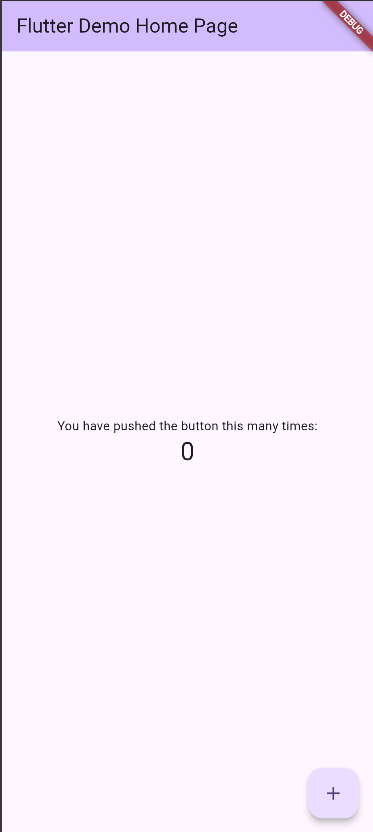
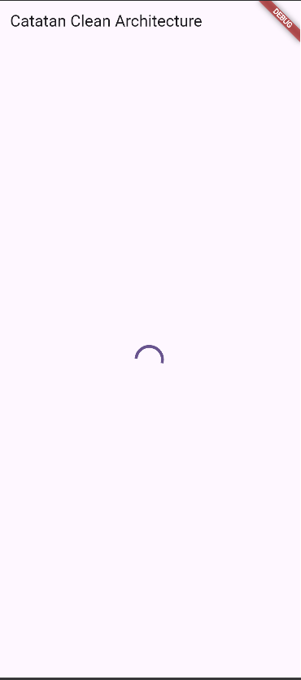

# Week 7 - Clean Architecture

**Nama:** Muhammad Nawfal Mawla Azhar
**NIM:** 244107020174
**Kelas:** TI - 3G

## Tujuan Pembelajaran

Setelah menyelesaikan codelab ini, saya dapat:

- menjelaskan prinsip SOLID dan separation of concerns dengan contoh kode Flutter;
- membedakan struktur feature-first dan layer-first beserta trade-off-nya;
- menjelaskan tiga layer, yaitu presentation, domain, dan data, serta aturan dependensi yang mengarah ke dalam;
- membedakan entity dan model serta memahami peran repository, use case, dan dependency injection;
- merefactor project Minggu 5/6 menjadi struktur feature-first yang terpisah layer-nya;
- menguji use case dengan repository palsu tanpa database atau jaringan sungguhan.

## Dokumentasi Screenshot

### Audit Project Sebelum Refactor

> Kondisi struktur dan dependency project sebelum dilakukan refactor.

> 

### Struktur Project Setelah Refactor

> Kondisi project setelah provider dan repository dipisahkan sesuai layer Clean Architecture.

 > 

 ## Refleksi

 1. Mengapa interface repository harus tinggal di domain, bukan di data? Apa yang rusak bila dibalik?
Interface diletakkan di layer domain untuk mematuhi Dependency Inversion Principle. Layer domain yang berisi logika inti tidak boleh bergantung pada detail eksternal. Jika dibalik (interface di data), layer domain terpaksa harus meng-import layer data. Hal ini merusak arah dependensi (yang seharusnya hanya mengarah ke dalam), membuat kode bisnis terikat erat pada teknologi spesifik (seperti SQLite atau Dio), dan membuat logika aplikasi sangat sulit untuk diuji (unit test) menggunakan data palsu (mocking).

2. Kapan use case benar-benar dibutuhkan, dan kapan repository langsung ke notifier sudah cukup?
Use case wajib digunakan saat terdapat logika bisnis yang kompleks, validasi beruntun, atau ketika satu aksi (misalnya: proses sinkronisasi) membutuhkan interaksi dengan lebih dari satu repository sekaligus (orkestrasi). Namun, untuk operasi CRUD standar yang sederhana (misalnya: hanya mengambil daftar catatan atau menyimpan entitas tanpa logika tambahan), memanggil repository langsung dari Notifier/Provider sudah sangat cukup.

3. Apa biaya over-engineering (use case per CRUD satu-baris) bagi tim kecil? Kapan biayanya sepadan?
Biaya over-engineering bagi tim kecil adalah melambatnya kecepatan development, jumlah file (boilerplate) yang membengkak secara tidak perlu, dan navigasi kode yang menjadi membingungkan. Biaya dan usaha ekstra ini baru menjadi sepadan pada project berskala enterprise dengan puluhan developer, di mana aplikasi memiliki aturan bisnis yang sangat rumit dan sering berubah secara independen dari tampilan UI-nya.

4. Bagian mana dari usulan AI yang Anda tolak atau sederhanakan, dan mengapa?
Bagian yang ditolak/disederhanakan pada AI Challenge sebelumnya adalah pembuatan file Use Case terpisah untuk setiap operasi CRUD sederhana (contohnya GetAnnouncements yang di dalamnya hanya berisi 1 baris kode untuk meneruskan panggilan ke fungsi di Repository). Hal ini disederhanakan dengan menyambungkan Provider Riverpod langsung ke Repository. Tujuannya adalah untuk menghindari boilerplate code (penumpukan file yang isinya hampir kosong), menjaga struktur arsitektur tetap pragmatis, dan memudahkan maintenance kode oleh tim kecil tanpa melanggar batas sterilitas layer Clean Architecture.
